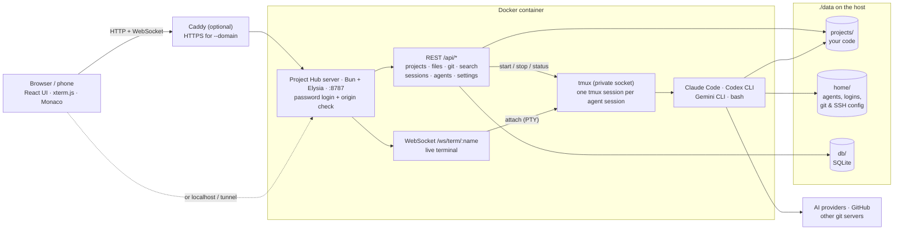
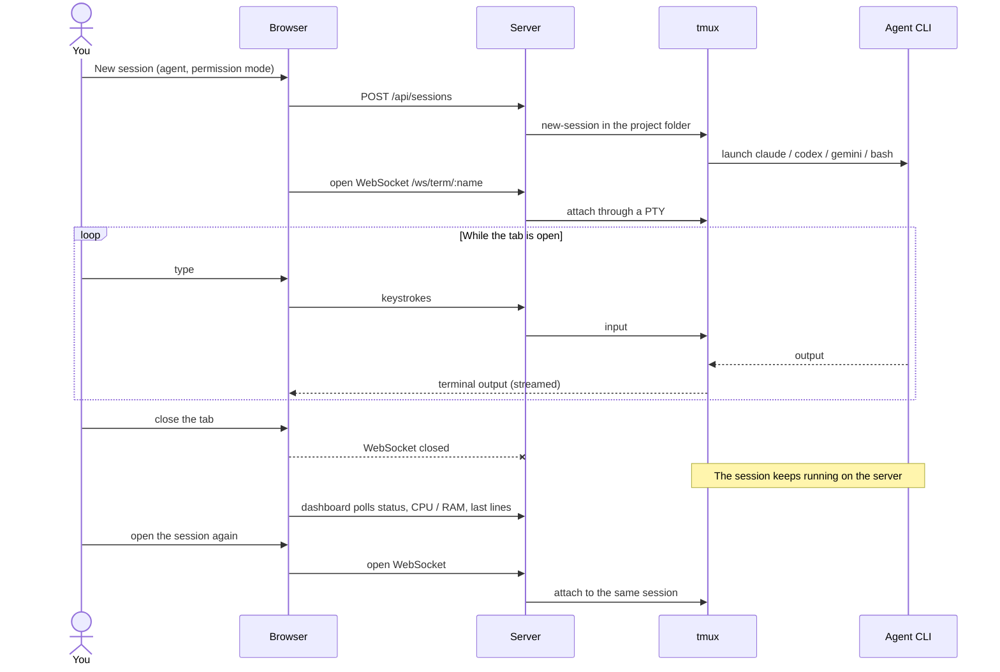

# Project Hub

A self-hosted web dashboard for your code projects and AI coding agents — **Claude Code**, **Codex CLI**,
**Gemini CLI** and more — running in a single Docker container. Open it from any browser (phone included),
start agent sessions in your projects, and close the tab: sessions keep running on the server.

Nothing but Docker is installed on the host. Agents, their logins, GitHub access and git settings are all
set up from the dashboard.

## Features

- **Projects**: create (empty folder, `git init` or `git clone`), rename, move to trash, restore.
- **Agent sessions**, several at once per project, in a web terminal (tmux under the hood):
  - Claude Code, Codex CLI, Gemini CLI — pick a permission mode per session, continue the last conversation.
  - **Claude Remote Control**: drive a session from claude.ai/code or the Claude mobile app.
  - Plain **bash** terminal in the project folder.
- **Settings in the browser**: install / update / log in to each agent, or paste an API key; log in to
  GitHub (device code or token); git name and email; SSH key for other git servers.
- **Monitoring**: active / waiting / exited status, CPU and RAM per session, last output lines, server load.
- **Files**: file tree, Monaco editor (Ctrl+S), quick open (Ctrl+P), search across files, upload / download.
- **Git**: stage, commit, push, pull, branches, stash, diffs, recent commits.
- **Mobile friendly**: bottom navigation, a text box for long prompts, sticky Ctrl, arrow keys, history scrolling.

## How it works

Everything runs in one Docker container. The browser talks to a small Bun server, and every agent runs
inside a tmux session on that server, so it keeps running when you close the tab.



What happens when you start a session and come back later:



- **Nothing on the host but Docker.** Agents, logins and settings live in `./data`, so backing up that
  folder backs up everything.
- **Sessions are tmux sessions.** Closing the browser or losing your connection does not stop them.
  Restarting the container does, but you can pick up conversations again with **Resume**.
- **Every API and terminal request** needs a logged-in session and must come from an allowed origin.

The source layout is described in [docs/development.md](docs/development.md).

## Quick start

On a Linux server or a Mac with Docker:

```bash
curl -fsSL https://raw.githubusercontent.com/suriyadi15/project-hub/main/install.sh | bash
```

The installer puts everything in `~/project-hub`, starts the container and prints a link like
`http://localhost:8787/setup?token=…`. Open it, choose a password, then go to **Settings** to install an
agent and connect GitHub.

On a server with a domain name, get HTTPS with automatic certificates in the same step:

```bash
curl -fsSL https://raw.githubusercontent.com/suriyadi15/project-hub/main/install.sh | bash -s -- --domain hub.example.com
```

Or let your AI agent do it: install the [Project Hub skill](docs/ai-install.md) (Claude Code:
`/plugin install project-hub --marketplace suriyadi15/project-hub`) and ask *"Install Project Hub on this
machine"*.

Prefer to do it by hand? It is just a compose file:

```bash
mkdir project-hub && cd project-hub
curl -fsSLO https://raw.githubusercontent.com/suriyadi15/project-hub/main/docker-compose.yml
echo "PUID=$(id -u)" > .env && echo "PGID=$(id -g)" >> .env
docker compose up -d
docker compose logs project-hub   # shows the setup link
```

## Updating

Re-run the installer, or in the install folder:

```bash
docker compose pull && docker compose up -d
```

Updating restarts the container, which stops running sessions. Conversations are kept; continue them with
**Resume** on the project page. Installed agents live in the data folder and update themselves (or use
**Update** in Settings).

## Where things are stored

Everything is in `./data` next to `docker-compose.yml`:

| Folder | Contents |
|---|---|
| `data/projects` | Your projects |
| `data/home` | Home folder of the container user: installed agents, their logins and history, GitHub CLI login, git config, SSH keys |
| `data/db` | Dashboard database (password, settings, session history) |

Back up `data/` to back up everything. See [docs/configuration.md](docs/configuration.md) to put projects
somewhere else or share folders with the host.

## Documentation

- [Installation](docs/installation.md) — requirements, installer options, manual install, uninstall
- [Install with an AI agent](docs/ai-install.md) — skill for Claude Code, Codex and other agents
- [Configuration](docs/configuration.md) — `.env` options, data folders, resource limits
- [Agents](docs/agents.md) — installing, logging in, API keys, permission modes
- [GitHub & git](docs/github.md) — connecting GitHub, other git servers
- [Remote access](docs/reverse-proxy.md) — built-in HTTPS, Caddy / nginx, Cloudflare Tunnel, SSH tunnel
- [Security](docs/security.md) — what the dashboard can do and how it is protected
- [Development](docs/development.md) — running from source, architecture
- [Adding an agent](docs/adding-an-agent.md) — support another CLI in a few lines
- [Advanced](docs/advanced.md) — sharing host folders, migrating an existing setup

## Security

The dashboard gives **full shell access** to the container, including your agent and GitHub credentials.
By default it only listens on `127.0.0.1`. Expose it only over HTTPS, with a strong password, and ideally
behind an extra login layer such as Cloudflare Access or a VPN. Details in [docs/security.md](docs/security.md).

## Stack

| Part | Technology |
|---|---|
| Runtime | Bun, Node.js (for npm-based agents) |
| Backend | Elysia, SQLite (`bun:sqlite`), tmux, Bun's built-in PTY |
| API client | Eden Treaty (types straight from the backend) |
| Frontend | React 19, Vite, React Router, TanStack Query |
| UI | Tailwind CSS v4, shadcn/ui (Radix), lucide-react, sonner |
| Terminal / editor | xterm.js / Monaco |

## Contributing

Issues and pull requests are welcome — see [CONTRIBUTING.md](CONTRIBUTING.md).

## License

[MIT](LICENSE)
